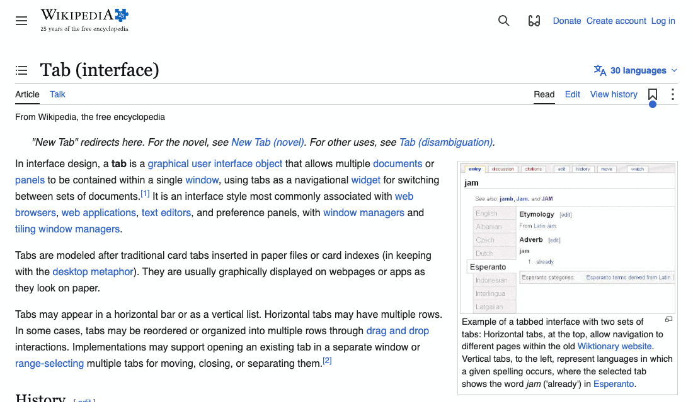

<p align="center"></p>

<h1 align="center">Tab Switcher</h1>

<p align="center">Ctrl+Tab in most-recently-used order for Chrome, like Cmd+Tab on macOS.</p>

<p align="center">
  <a href="LICENSE"></a>
  
  
</p>

Chrome's own Ctrl+Tab moves to the tab on the right. This extension makes it switch in most-recently-used order, like Cmd+Tab on macOS: a quick Ctrl+Tab goes back to the last tab you used, and keeping Ctrl down shows your tabs in a row, with a thumbnail of each. Releasing Ctrl opens the selected tab.



While the list is open: Tab moves the selection, Shift+Tab moves it backwards, the mouse over a tab selects it, a click opens it, Enter opens the selection and Escape cancels.

It is not on the Chrome Web Store: you build it and load it unpacked. It needs Chrome 121 or later, Node 22.12 or later and pnpm.

## What it can access

Chrome says this extension can read and change your data on all sites. It needs that for two things: a script in every page that watches the Control key and draws the list, and a screenshot of the tab you are on, which becomes its thumbnail. The script reacts only to Control, to Enter and Escape and to the mouse while the list is open; it does not read the page or keep anything you type.

- `tabs`: the title and address of each tab, for the list.
- `storage`: the tab order and the thumbnails, kept in `chrome.storage.session`, in memory only: never written to disk, never sent anywhere, gone when Chrome closes.
- `scripting`: puts the script back into open tabs after an install or a reload.
- `favicon`: tab icons, from Chrome's own cache.

The extension makes no network requests.

## Install

1. Clone the repo, run `pnpm install`, then `pnpm build`. The extension is built into `dist/`.
2. Open `chrome://extensions`, turn on Developer mode, choose **Load unpacked** and pick the `dist/` folder.
3. Bind the shortcuts. Chrome's shortcuts page does not accept Tab, so the binding goes through the console. The snippet names the extension by its id, which the `key` in the manifest keeps the same on every machine. Open `chrome://extensions/shortcuts`, open DevTools there (Cmd+Option+J on macOS, Ctrl+Shift+J elsewhere) and run:

   ```js
   for (const [commandName, keybinding] of [
   	["next", "Ctrl+Tab"],
   	["previous", "Ctrl+Shift+Tab"],
   ]) {
   	chrome.developerPrivate.updateExtensionCommand({
   		extensionId: "nledhmbfapnbdoigjilconkgblbadchk",
   		commandName,
   		keybinding,
   	});
   }
   ```

   If the console refuses to paste, type `allow pasting` first. On macOS `Ctrl` here is the Control key, not Command. The page should then list both shortcuts under Tab Switcher.

## Limits

- The list is drawn inside the page. Where an extension cannot run a script (`chrome://` pages, the New Tab page, the Chrome Web Store, the PDF viewer) and when the focus is in the address bar, Ctrl+Tab switches straight to the previous tab without the list.
- The order starts again at every browser restart, from the time each tab was last used. So do the thumbnails: a tab gets one the first time you look at it.
- A thumbnail shows the tab as it was shortly after you arrived on it.

## Development

| | |
|---|---|
| `pnpm dev` | rebuilds `dist/` on every change to `src/`; then reload the extension in `chrome://extensions` |
| `pnpm test` · `pnpm typecheck` · `pnpm format` | Vitest, tsc, Prettier |
| `pnpm build` | a clean build into `dist/` |
| `pnpm icons` | after editing `assets/icon.svg`: renders the PNGs in `static/icons/` |

Decisions and plans are in [SPEC.md](SPEC.md), changes in [CHANGELOG.md](CHANGELOG.md).

## License

MIT, see [LICENSE](LICENSE).
